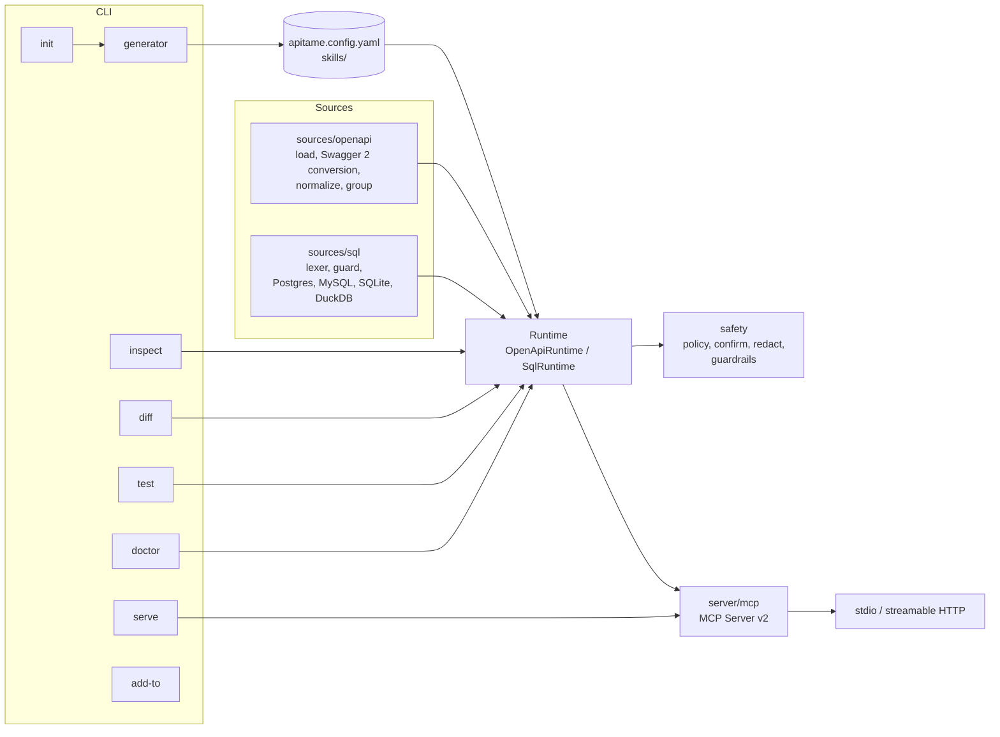

# Architecture

apitame is one TypeScript package with a CLI on top of a small set of modules. There is no code generation: `init` writes a config file and skills, and `serve` builds the tools from the config and the source at startup.

## Modules

| Path | Responsibility |
| --- | --- |
| `src/cli.ts`, `src/cli/` | Command parsing (commander) and the seven commands: `init`, `serve`, `inspect`, `diff`, `test`, `doctor`, `add-to`. Terminal output only; no business logic. |
| `src/config/` | Zod schema for `apitame.config.yaml`, YAML loading, `${VAR}` resolution (and of secret manager references already read), `.env` loading. |
| `src/sources/openapi/` | Load and dereference specs (file or URL, external refs, discovery), convert Swagger 2.0 in memory (`swagger2.ts`), normalize operations and body kinds, compact JSON Schemas, classify access, detect how list operations page (`pagination.ts`), group operations into tools. |
| `src/sources/sql/` | Database-accurate lexer (PostgreSQL, MySQL, SQLite and DuckDB rules), the SELECT guard, write classification, named parameter binding, and the PostgreSQL, MySQL, SQLite and DuckDB drivers (each with a `privileges()` check). DuckDB's parser layer (`duckdb-guard.ts`) asks DuckDB itself, its driver package is an optional peer dependency, and all DuckDB work runs in a child process (`duckdb-worker.ts`, built to `dist/duckdb-worker.js`) that is killed on timeout. Loaded on demand. |
| `src/server/` | Runtimes that turn a source into tools, the HTTP client (redirect policy, uploads, size caps), response field selection (`fields.ts`), following pages of list operations (`pages.ts`), argument validation, the MCP server wiring, transports, OAuth access token checks for the HTTP transport (`oauth.ts` for JWTs and the claim checks both paths share, `introspection.ts` for RFC 7662 token introspection and `verify: auto`), and skills over MCP. |
| `src/safety/` | The policy decision (`decide`), per-user permissions for OAuth callers (`permissions.ts`, which `decide` applies after the server config), argument rules for writes (`rules.ts`, with a linear-time matcher for `pattern` in `pattern.ts`), confirmation tokens, approval ids and the elicitation flow for both protocol eras, the redactor, and `guardrails.ts` (per-minute rate limits, server-wide and per OAuth caller, and the JSON Lines audit log, shared by both runtimes). |
| `src/auth/` | Bearer, API key, basic and OAuth2 client credentials providers. |
| `src/secrets/` | Secret manager references (`${op://...}`, `${aws-sm://...}`, `${gcp-sm://...}`): the reference patterns, the command line and answer of each CLI, running a CLI without a shell (minimal environment, deadline, output cap, process group killed), and the resolver that reads every reference once, all or nothing, before a runtime is built. |
| `src/generator/` | Config file rendering (with comments), skill generation, and a small ZIP writer for packaging skills as uploads. |
| `src/mock/` | Sample values from JSON Schema and the mock HTTP server used by `test`. |
| `src/diff/` | `apitame diff`: builds two versions of a spec into runtimes with the same config and compares operations, access levels, allowed writes, config references, write arguments and token cost. Reads specs only. |
| `src/tokens/` | Token estimation for tool lists. |
| `src/telemetry/` | Optional OpenTelemetry export: settings from the `OTEL_*` variables (`config.ts`, no OpenTelemetry code), the loader that imports the implementation only when an endpoint is set and explains missing packages (`index.ts`), and the one module that imports the optional `@opentelemetry/*` peers (`otel.ts`): one span per `tools/call` after the MCP semantic conventions, call and duration metrics, and a bounded flush on shutdown. |
| `src/util/` | Small shared helpers: `withDeadline` gives an outgoing request one deadline, held by a timer, that covers the body too and survives garbage collection. |

## Request flow (OpenAPI)

1. The MCP client calls `tools/call` with a tool name and arguments.
2. `server/mcp.ts` passes them to the runtime with a call context: on a 2025-era connection it can elicit input from the human in the middle of the call; on protocol 2026-07-28 it carries the client's capabilities and, on a second round, the human's answer and the approval id (see [Protocol eras](#protocol-eras)).
3. The guardrails check the per-minute call budget.
4. `OpenApiRuntime` resolves the operation (from `operation` for grouped tools, the tool itself for single-operation tools, or `operationId` for `call_operation`).
5. `safety/policy.decide` returns allowed, blocked (with a reason and a hint), or allowed with confirmation.
6. Arguments are validated with Ajv against the operation's compact schema. Writes are then checked against `writes.rules` (`safety/rules.ts`); a call that breaks a rule is refused here, before any preview, approval or rate limit.
7. `http-client.buildRequest` builds the URL (refusing dot segments), query, headers and body (JSON, form, multipart or binary, with the upload cap). With `dryRun`, the redacted request is returned here, files summarized.
8. If confirmation is needed (after a check that the write budget is not used up, so a rate-limited call never asks), `safety/confirm.confirmOrChallenge` elicits approval, returns the approval form with a new approval id (2026-07-28 first round), checks the answer and the approval id (second round), or issues or checks a one-time token. Writes then take a slot of the per-minute write budget.
9. `http-client.sendRequest` applies auth, follows redirects (credentials only to the same origin), enforces the timeout, retries once on 401 for OAuth2, applies `fields`, and trims large JSON.
10. For an operation that pages, the runtime applies `fields`, redaction and the size cap itself, and with `pages` reads the following pages (`readPages`): each request is built from the same operation and arguments with only the position replaced and validated again, under the same deadline, with every page counted against the per-minute limits, and the lists are merged.
11. Every write outcome (and every call with `include: all`) is appended to the audit log; the result goes through the redactor and back to the client as compact JSON.
12. With telemetry on, `mcp.ts` opens a span when the call arrives and hands the runtime an `observe` callback in the call context. `guardrails.recordCall` passes it the safe fields of every audit entry (outcome, access, operation, status, never arguments or reasons), whether or not the audit file records it, and the span ends with the result.

## Request flow (SQL)

1. `query` arguments go to `guardSelect` (lexer checks, then parser checks, then table allow and deny lists). For DuckDB, `guardDuckdbSelect` runs the same lexer and then DuckDB's own parser (`json_serialize_sql`) on a separate in-memory database.
2. The driver runs the cleaned SQL: PostgreSQL in a read-only transaction through a cursor with the extended protocol; MySQL in a read-only transaction with `max_execution_time` and `sql_select_limit`; SQLite in a worker thread on a read-only connection; DuckDB in a child process (killed when the timeout passes), in a new read-only, locked-down instance per call, after DuckDB confirms one SELECT statement.
3. Rows come back as arrays, trimmed to the row limit and the response size cap, then redacted.

Named queries are validated once at startup. Write queries go through the same policy, argument rules and confirmation code as HTTP writes; their dry run is a transaction that is rolled back.

## Protocol eras

MCP protocol 2026-07-28 changed how a server asks the client for input: every request carries the client's capabilities, and a server never sends requests to the client. apitame serves both eras with one server definition (`createMcpServer`), through the SDK's era-aware entries:

- **stdio**: `serveStdio` from the SDK reads the client's first message, builds one server for the connection and pins it to that era. A 2025-era connection is served exactly as a server connected to the transport directly.
- **HTTP**: `server/transport.ts` runs the Host, Origin, token and OAuth checks first, reads and parses the body once (at most 1 MB without a session id when sessions are on, else 4 MB), and classifies the request with the SDK's `isLegacyRequest`. 2025-era requests go to the existing stateless or session wiring, unchanged, with the parsed body; for a body that is empty or not JSON the SDK transport finds nothing to read and answers with its own parse error, as before. 2026-07-28 requests go to the SDK's `createMcpHandler` (strict, `legacy: 'reject'`), which builds a server per request, with `subscriptions/listen` streams limited like sessions (in all, and per OAuth user). JSON that is not a JSON-RPC message belongs to neither era and is answered by the 2025-era wiring, as before.

Approvals differ by era (and `serveHttp` marks the servers it serves without a token or OAuth, so that `confirmation.method: elicitation` refuses approvals there, in both eras, before anyone is asked). On a 2025-era connection, `mcp.ts` calls `elicitInput()` during the tool call. On 2026-07-28, `confirmOrChallenge` stores an approval id (bound to the operation, a hash of the arguments and the OAuth caller) in the runtime's `ConfirmationStore`, in a map separate from confirm tokens, and the call returns an input-required result with the form and the id as `requestState`. The client calls again with the answer; the id is checked and used up. Because the id lives in the shared runtime, the two rounds can be served by two different per-request servers. The SDK's legacy shim, which could also fulfil input-required results on 2025-era connections, is turned off so that path never bypasses the audit log.

List changes (`serve --watch`) reach 2025-era clients through their own server, and 2026-07-28 clients through `subscriptions/listen`: over HTTP from an event bus that `serve` publishes to, over stdio from the connection's server.

## Why a low-level MCP server

Tool input schemas are generated JSON Schema, not Zod objects written by hand. The runtime builds `ToolDefinition` objects and the low-level `Server` from the MCP TypeScript SDK v2 serves them unchanged, so what `apitame inspect` measures is exactly what clients receive.

## Testing

- `tests/unit`: guard (about 160 cases across three dialects, including parser/database differentials), policy, confirmation, redaction, guardrails, config, schema compaction, Swagger 2.0 conversion, grouping, request building, redirects, uploads, field selection, auth, ZIP output, token estimation, the spec comparison behind `diff`, and secret manager references (patterns and hostile references, command lines, answers, the environment each CLI gets, the resolver with a fake runner).
- `tests/integration`: the OpenAPI runtime against the mock server (blocking, allowlist, confirmation, dry run, redaction), the MCP protocol over an in-memory transport (including elicitation and skills), approvals for 2026-07-28 clients over stdio, stateless HTTP and HTTP sessions (tampered, replayed and expired approval ids, changed arguments, OAuth users, the checks in front of the handler), per-user permissions with OAuth tokens of different scopes and clients (tool lists in both eras, refused writes, per-user rate limits, SQL named queries, config warnings), `doctor` (including its HTTP deployment checks against a fake authorization server and fake reverse proxies on 127.0.0.1), and the SQL runtime against SQLite, DuckDB, PGlite and, in CI, real PostgreSQL 17 and MySQL 8.4 servers (timeouts, read-only roles, injection payloads). DuckDB runs from the development dependency, with no server; its tests check each safety layer on its own. Secret manager CLIs run for real as fake scripts on POSIX systems: their arguments and environment, the deadline and output cap (with the process group killed), what a failing CLI printed never shown, redaction of the values read, and `doctor`; the end-to-end suite starts `serve` and `init --skills-only` with a fake `op`.
- Telemetry: spans and metrics for every outcome through the MCP layer with in-memory exporters (no secret from the arguments, the response or the credentials in any exported value), caller identity and trace context over HTTP with OAuth, real OTLP export to a receiver on 127.0.0.1, and a bounded shutdown against a collector that never answers. An end-to-end test runs `serve` over stdio with a module hook that records every `@opentelemetry/*` import: none without an endpoint, and a warning (with the server still serving) when the hook makes them fail as in a default install.
- `tests/e2e`: the CLI as users run it, including stdio MCP sessions in both protocol eras, an approval and `--watch` over HTTP for a 2026-07-28 client, every `add-to` client, and `diff` with every `--fail-on` category.

CI runs on Linux (Node 22, 24), macOS and Windows, plus a packed-tarball smoke test (which also runs a DuckDB file through `npx -p apitame -p @duckdb/node-api@1.5.6-r.1`, and checks that `serve` warns without the OpenTelemetry packages and that `npx -p` with them makes them load), the real-database job, and a container image smoke test (`scripts/docker-smoke.sh`: the image refuses to start without authentication, then serves `/health` and MCP read-only as a non-root user). The test suite itself never needs Docker.

See [decisions.md](decisions.md) for the reasoning behind the main choices.
