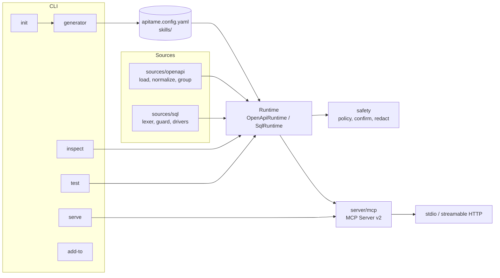

# Architecture

apitame is one TypeScript package with a CLI on top of a small set of modules. There is no code generation: `init` writes a config file and skills, and `serve` builds the tools from the config and the source at startup.

## Modules

| Path | Responsibility |
| --- | --- |
| `src/cli.ts`, `src/cli/` | Command parsing (commander) and the five commands. Terminal output only; no business logic. |
| `src/config/` | Zod schema for `apitame.config.yaml`, YAML loading, `${VAR}` resolution, `.env` loading. |
| `src/sources/openapi/` | Load and dereference specs (file or URL, external refs, discovery), normalize operations, compact JSON Schemas, classify access, group operations into tools. |
| `src/sources/sql/` | Database-accurate lexer, the SELECT guard, write classification, named parameter binding, PostgreSQL and SQLite drivers. |
| `src/server/` | Runtimes that turn a source into tools, the HTTP client, argument validation, the MCP server wiring, transports, and skills over MCP. |
| `src/safety/` | The policy decision (`decide`), confirmation tokens and elicitation flow, and the redactor. |
| `src/auth/` | Bearer, API key, basic and OAuth2 client credentials providers. |
| `src/generator/` | Config file rendering (with comments) and skill generation. |
| `src/mock/` | Sample values from JSON Schema and the mock HTTP server used by `test`. |
| `src/tokens/` | Token estimation for tool lists. |

## Request flow (OpenAPI)

1. The MCP client calls `tools/call` with a tool name and arguments.
2. `server/mcp.ts` passes them to the runtime with a call context that can elicit input from the human.
3. `OpenApiRuntime` resolves the operation (from `operation` for grouped tools, the tool itself for single-operation tools, or `operationId` for `call_operation`).
4. `safety/policy.decide` returns allowed, blocked (with a reason and a hint), or allowed with confirmation.
5. Arguments are validated with Ajv against the operation's compact schema.
6. `http-client.buildRequest` builds the URL, query, headers and body. With `dryRun`, the redacted request is returned here.
7. If confirmation is needed, `safety/confirm.confirmOrChallenge` elicits approval or issues or checks a one-time token.
8. `http-client.sendRequest` applies auth, the timeout and the response size cap, retries once on 401 for OAuth2, and trims large JSON.
9. The result goes through the redactor and back to the client as compact JSON.

## Request flow (SQL)

1. `query` arguments go to `guardSelect` (lexer checks, then parser checks, then table allow and deny lists).
2. The driver runs the cleaned SQL: PostgreSQL in a read-only transaction through a cursor with the extended protocol; SQLite in a worker thread on a read-only connection.
3. Rows come back as arrays, trimmed to the row limit and the response size cap, then redacted.

Named queries are validated once at startup. Write queries go through the same policy and confirmation code as HTTP writes; their dry run is a transaction that is rolled back.

## Why a low-level MCP server

Tool input schemas are generated JSON Schema, not Zod objects written by hand. The runtime builds `ToolDefinition` objects and the low-level `Server` from the MCP TypeScript SDK v2 serves them unchanged, so what `apitame inspect` measures is exactly what clients receive.

## Testing

- `tests/unit`: guard (113 cases including differential attacks), policy, confirmation, redaction, config, schema compaction, grouping, request building, auth and token estimation.
- `tests/integration`: the OpenAPI runtime against the mock server (blocking, allowlist, confirmation, dry run, redaction), the MCP protocol over an in-memory transport (including elicitation and skills), and the SQL runtime against real SQLite and real PostgreSQL (PGlite over the wire protocol), including timeouts and injection payloads.
- `tests/e2e`: the CLI as users run it, including a stdio MCP session.

See [decisions.md](decisions.md) for the reasoning behind the main choices.
