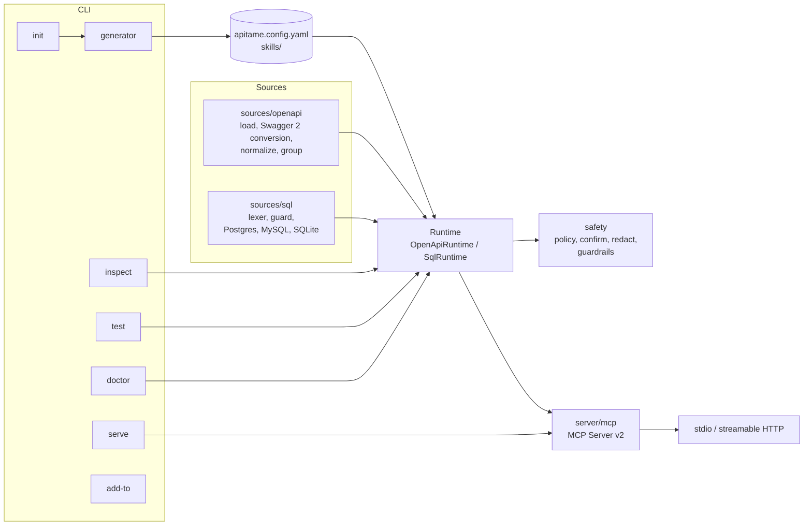

# Architecture

apitame is one TypeScript package with a CLI on top of a small set of modules. There is no code generation: `init` writes a config file and skills, and `serve` builds the tools from the config and the source at startup.

## Modules

| Path | Responsibility |
| --- | --- |
| `src/cli.ts`, `src/cli/` | Command parsing (commander) and the six commands: `init`, `serve`, `inspect`, `test`, `doctor`, `add-to`. Terminal output only; no business logic. |
| `src/config/` | Zod schema for `apitame.config.yaml`, YAML loading, `${VAR}` resolution, `.env` loading. |
| `src/sources/openapi/` | Load and dereference specs (file or URL, external refs, discovery), convert Swagger 2.0 in memory (`swagger2.ts`), normalize operations and body kinds, compact JSON Schemas, classify access, group operations into tools. |
| `src/sources/sql/` | Database-accurate lexer (PostgreSQL, MySQL and SQLite rules), the SELECT guard, write classification, named parameter binding, and the PostgreSQL, MySQL and SQLite drivers (each with a `privileges()` check). Loaded on demand. |
| `src/server/` | Runtimes that turn a source into tools, the HTTP client (redirect policy, uploads, size caps), response field selection (`fields.ts`), argument validation, the MCP server wiring, transports, and skills over MCP. |
| `src/safety/` | The policy decision (`decide`), confirmation tokens and elicitation flow, the redactor, and `guardrails.ts` (per-minute rate limits and the JSON Lines audit log, shared by both runtimes). |
| `src/auth/` | Bearer, API key, basic and OAuth2 client credentials providers. |
| `src/generator/` | Config file rendering (with comments), skill generation, and a small ZIP writer for packaging skills as uploads. |
| `src/mock/` | Sample values from JSON Schema and the mock HTTP server used by `test`. |
| `src/tokens/` | Token estimation for tool lists. |

## Request flow (OpenAPI)

1. The MCP client calls `tools/call` with a tool name and arguments.
2. `server/mcp.ts` passes them to the runtime with a call context that can elicit input from the human.
3. The guardrails check the per-minute call budget.
4. `OpenApiRuntime` resolves the operation (from `operation` for grouped tools, the tool itself for single-operation tools, or `operationId` for `call_operation`).
5. `safety/policy.decide` returns allowed, blocked (with a reason and a hint), or allowed with confirmation.
6. Arguments are validated with Ajv against the operation's compact schema.
7. `http-client.buildRequest` builds the URL (refusing dot segments), query, headers and body (JSON, form, multipart or binary, with the upload cap). With `dryRun`, the redacted request is returned here, files summarized.
8. If confirmation is needed, `safety/confirm.confirmOrChallenge` elicits approval or issues or checks a one-time token. Writes then check the per-minute write budget.
9. `http-client.sendRequest` applies auth, follows redirects (credentials only to the same origin), enforces the timeout, retries once on 401 for OAuth2, applies `fields`, and trims large JSON.
10. Every write outcome (and every call with `include: all`) is appended to the audit log; the result goes through the redactor and back to the client as compact JSON.

## Request flow (SQL)

1. `query` arguments go to `guardSelect` (lexer checks, then parser checks, then table allow and deny lists).
2. The driver runs the cleaned SQL: PostgreSQL in a read-only transaction through a cursor with the extended protocol; MySQL in a read-only transaction with `max_execution_time` and `sql_select_limit`; SQLite in a worker thread on a read-only connection.
3. Rows come back as arrays, trimmed to the row limit and the response size cap, then redacted.

Named queries are validated once at startup. Write queries go through the same policy and confirmation code as HTTP writes; their dry run is a transaction that is rolled back.

## Why a low-level MCP server

Tool input schemas are generated JSON Schema, not Zod objects written by hand. The runtime builds `ToolDefinition` objects and the low-level `Server` from the MCP TypeScript SDK v2 serves them unchanged, so what `apitame inspect` measures is exactly what clients receive.

## Testing

- `tests/unit`: guard (about 160 cases across three dialects, including parser/database differentials), policy, confirmation, redaction, guardrails, config, schema compaction, Swagger 2.0 conversion, grouping, request building, redirects, uploads, field selection, auth, ZIP output and token estimation.
- `tests/integration`: the OpenAPI runtime against the mock server (blocking, allowlist, confirmation, dry run, redaction), the MCP protocol over an in-memory transport (including elicitation and skills), `doctor`, and the SQL runtime against SQLite, PGlite and, in CI, real PostgreSQL 17 and MySQL 8.4 servers (timeouts, read-only roles, injection payloads).
- `tests/e2e`: the CLI as users run it, including a stdio MCP session and every `add-to` client.

CI runs on Linux (Node 20, 22, 24), macOS and Windows, plus a packed-tarball smoke test and the real-database job.

See [decisions.md](decisions.md) for the reasoning behind the main choices.
